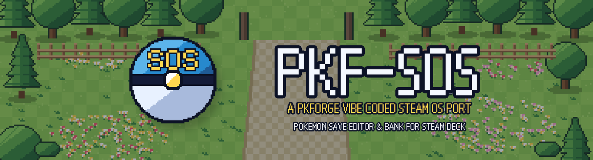
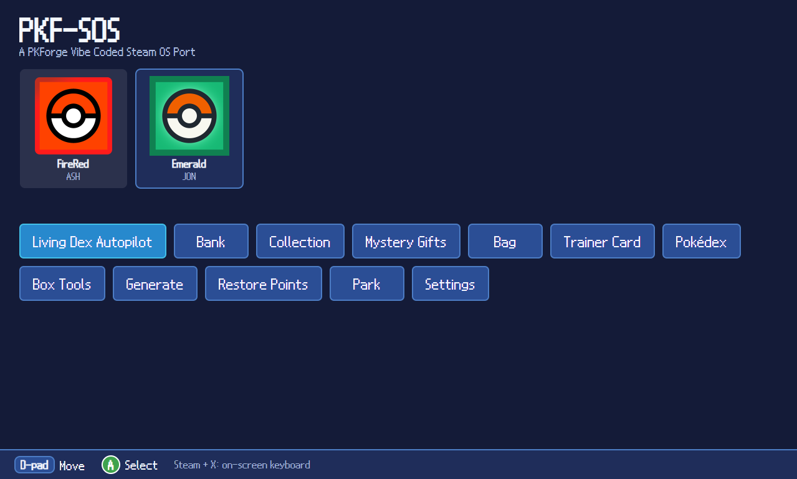
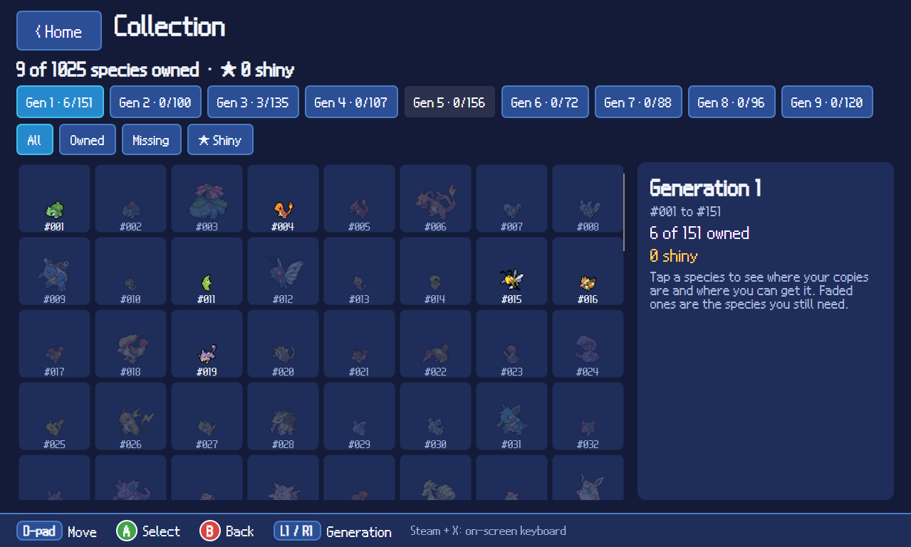
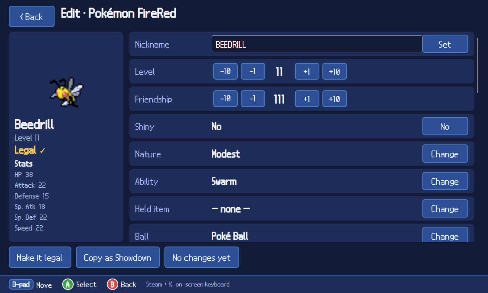
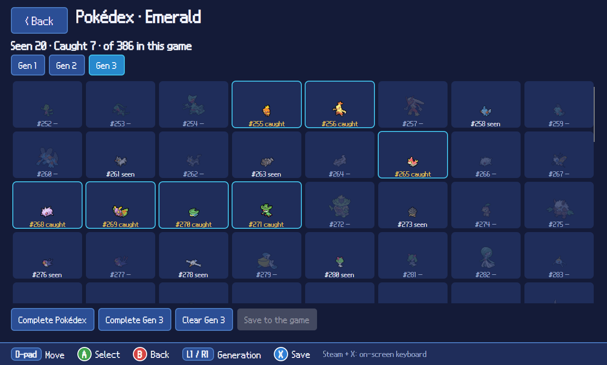
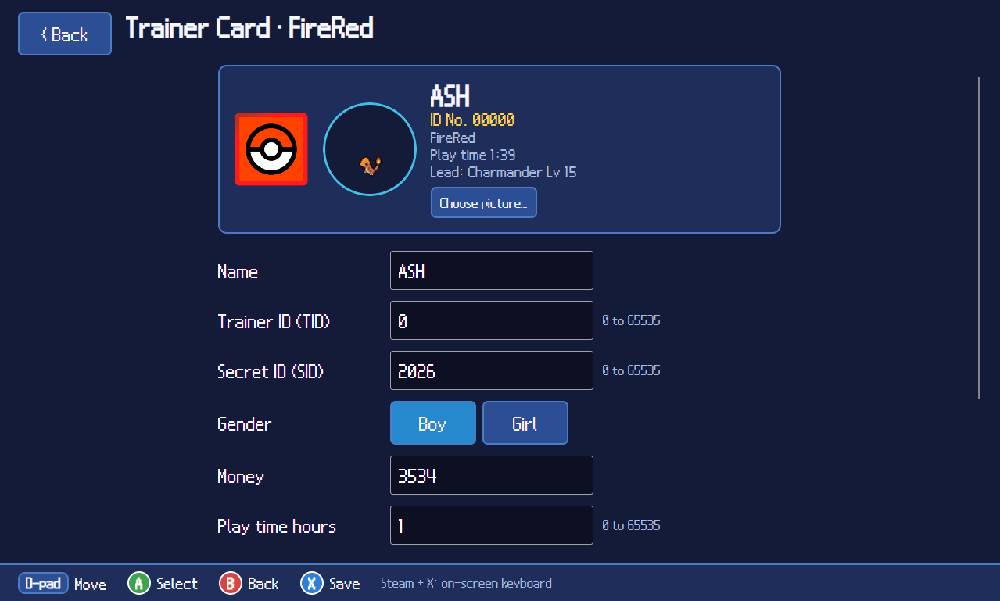
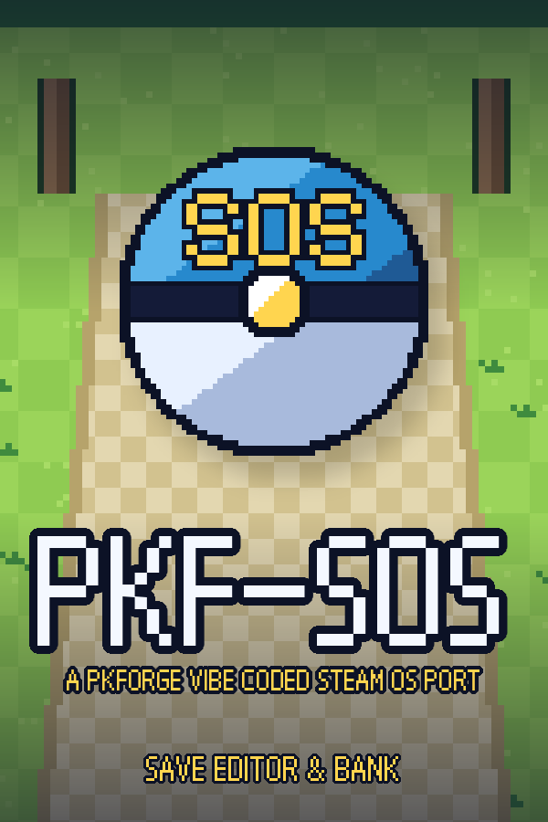
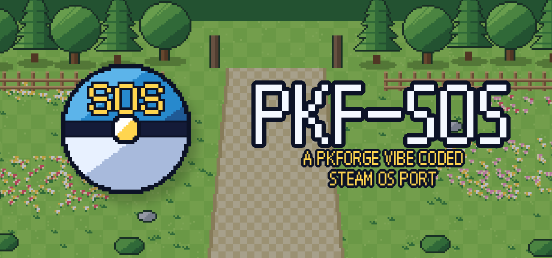

  
  
  
  

<b>A Pokémon save editor and Bank for the Steam Deck and other Linux handhelds. Controller first, touch friendly, shipped as an AppImage.</b>

---

> [!IMPORTANT]
> **This is not PKForge, and it is not made by the PKForge team.**
> PKF-SOS is an **unofficial, independent, community port** of the open-source Android app
> [PKForge by sofianeelhor](https://github.com/sofianeelhor/PKForge). The original author has **no affiliation** with
> this project, has not reviewed it, and does not support it. **Please do not ask the PKForge developer or the PKForge
> Discord for help with PKF-SOS.** Bugs in this port are this port's problem, not theirs.

> [!WARNING]
> **100% of the code in this port was written by AI.**
> The person running this repository has no programming background. Every line of the Linux interface, the build
> scripts and this page was generated by an AI assistant (Anthropic's Claude) from plain-English instructions, then
> built by GitHub Actions and tested by hand on one Steam Deck. See [How this was made](#how-this-was-made) and
> [Honest limitations](#honest-limitations) before you trust it with a save you care about.

## What is this?

PKForge is an excellent Pokémon save editor and cross-generation Bank for Android. It has no Linux version, so
Steam Deck players who run their emulators through EmuDeck could not use it. PKF-SOS takes the original app's open
source engine (the parts that read, edit and write saves) and puts a new, separate Linux interface on top of it,
designed for a handheld: big buttons, D-pad navigation and an on-screen hint bar.

The "SOS" is for **S**team**OS**, and the name is a nod to PKForge.

## Screenshots

  
  

  
  

  

*Screenshots are taken on a Steam Deck. The bar along the bottom always shows what each button does.*

## What is original and what is not

| Part | Where it comes from |
| --- | --- |
| Save reading and writing, legality, Bank, backups, Mystery Gift database, Living Dex logic | **The original PKForge**, unchanged apart from a couple of small additions (see below) |
| Pokémon data and save formats | **[PKHeX](https://github.com/kwsch/PKHeX)** by kwsch and contributors |
| Legalizing and generating Pokémon | **[Auto Legality Mod](https://github.com/santacrab2/PKHeX-Plugins)** by santacrab2 and contributors, via PKForge |
| The Linux user interface (every screen, the controller support, the Park, themes) | **Written by AI** for this port |
| Park backdrop pixel art | **Generated by AI** (drawn by a script, not copied from any game) |
| Game cover art, UI font, Pokémon sprites, navy colour scheme | From the original PKForge and PKHeX resources, under their own licences and attribution notes (see Credits) |

The original Android app is **not** included, copied or redistributed as a product. Only its engine code is reused,
as its licence allows.

## Features

Everything below exists in this port and has been built, though see the limitations section for how much of it has
actually been tested.

- **Saves list with cover-art thumbnails.** Point it at the folders your emulators use and it finds your saves. Folders
  and scanning live under **Settings**, along with UI Themes and a Controller Test screen.
- **Pokémon editor.** Stats, IVs, EVs, moves, nature, ability, held item, shininess, with a live legality check.
  Copy a Pokémon out as a Showdown set.
- **Collection.** A grid of every Pokémon you own across all games and the Bank. Edit any copy directly, including
  ones sitting in a save or the party. Tap a missing species to generate it.
- **Bank.** A cross-game Bank for storing Pokémon outside any game file.
- **Living Dex Autopilot.** Plans a living dex from what you already own. This port adds a **Move or Copy** choice,
  so you can copy into the Bank and keep the originals in your game.
- **Mystery Gifts.** Browse the bundled event database and send gifts to the Bank or into a save.
- **Bag editor, Trainer Card, Pokédex editor.** The Trainer Card shows your in-game character and lets you use a custom picture.
- **Box Tools.** Sort, swap and clear boxes, set everything shiny, heal, and find duplicates.
- **Generate Pokémon.** Build a legal Pokémon from scratch (species, level, nature, shiny, form), or paste Showdown sets.
  Send it to the Bank or into the game.
- **Showdown import and export.**
- **Restore Points.** Every write makes a restore point first. Roll any save back from a list.
- **The Park.** A small mini-game where Pokémon from your collection wander a pixel-art park, chat to each other, and
  can be petted and fed. It is purely cosmetic and **never changes your save files**.
- **UI Themes.** Eight colour themes, remembered between launches.
- **Controller support.** Everything works with the Steam Deck's D-pad and buttons, with an on-screen hint bar showing
  what each button does. Touch also works.

### How your saves are protected

These protections come from PKForge's engine and were kept:

- A **restore point is made before every write**.
- Saves are written **atomically**, so a crash mid-write cannot leave half a file.
- The app **refuses to write if the file changed on disk** since it opened it, for example because an emulator is
  still running.
- ROM-hack saves are not opened for writing.
- Nothing changes until you tap **Save**.

**Even so: always keep your own backups of saves you care about. Close your emulator before editing.**

### Not in this port (yet, maybe never)

Compared with the Android original, these are **not** implemented:
RNG tools, the Poképark (replaced by the simpler Park), Nuzlocke report, encounter browser, QR code and PKSM transfer,
Hardcore mode, item Mystery Gift cards, game-specific editors (event flags, daycare, roamers, honey trees, Poké Beans,
Grand Underground and similar), hex editor, box wallpapers, music, dual-screen support, and ROM-hack editing. This list
may be incomplete. If the original has it and it is not in the features list above, assume this port does not.

## Supported games and emulators

The engine underneath handles saves from Gen 1 to Gen 9. **In practice this port has only been tested with a small
number of saves** (see below), so treat everything else as "should work, unproven."

Folder types offered in Settings are aimed at the emulators installed by EmuDeck, such as **RetroArch** (Game Boy,
GBA, DS) and **Azahar** (3DS). You can also point it at any folder that contains saves.

## Install

1. Go to **Releases** in this repository and download `PKF-SOS-x86_64.AppImage`.
2. Make it executable (right-click, Properties, Permissions, "Allow executing as program"), then run it. In Steam
   Deck Desktop Mode you can add it to Steam as a non-Steam game to launch it from Gaming Mode.
3. Open **Settings → Folders** and add the folder that holds your saves.

Made for the Steam Deck's 1280×800 screen. Linux x86-64 only. No Windows, macOS or ARM builds.

## Add it to Steam (artwork included)

You can run PKF-SOS from Gaming Mode by adding it as a non-Steam game. A matching set of artwork (cover, banner,
logo, capsule and icon at Steam's sizes) is attached to the releases as **`pkf-sos-steam-art.zip`**.

  
  &nbsp;&nbsp;
  

1. In Desktop Mode, right-click the AppImage and add it to Steam, or use Steam's **Add a Non-Steam Game**.
2. In Gaming Mode, open its page, tap the cog, then **Manage**, then **Set custom artwork**, and pick the images.
3. The default controller layout works. If buttons ever seem dead, open **Settings → Controller Test** to see what the
   Deck is sending, and include a photo of it when you report the problem.

## How this was made

Transparency matters here, so exactly how:

- The project owner gave plain-English instructions (for example, "add a bag editor", "make it controller friendly").
- An AI assistant (Claude, by Anthropic) wrote all of the new code and the build setup.
- The AI **could not compile or run the program itself.** The owner uploaded the code to GitHub, where an automated
  build (GitHub Actions) compiled it, then pasted any build errors back to the AI to fix. The result was then tried
  by hand on a Steam Deck.
- No human has reviewed the code line by line. There is no automated test suite for the Linux interface.

## Honest limitations

- **Tested on one device** (a Steam Deck) by one person, with a handful of saves, mainly a Game Boy Advance game
  (FireRed) and a 3DS save. Other games, other emulators and other Linux machines are untested.
- **AI-written code can contain bugs**, including ones that only show up with certain saves. Several screens were
  added very recently and may crash or misbehave.
- Please **keep backups** and treat this as beta software.
- Bugs are fixed on a best-effort basis by the same AI-assisted process. There is no support team.

## Reporting problems

Open an **Issue in this repository**. Include which game, which emulator, what you tapped and any error message.
**Do not report PKF-SOS problems to the original PKForge project.**

## Credits and licence

PKF-SOS is licensed under the **GNU General Public License v3 or later**, inherited from PKForge and PKHeX.Core, and
is a derivative of PKForge. Credits below are carried over from the original project, because this port reuses its
engine, data and some of its art. Full attribution notes sit in the original project's `ATTRIBUTION.md` files.

- **[PKForge](https://github.com/sofianeelhor/PKForge)** by sofianeelhor: the original app and engine this is a port of
- **[PKHeX](https://github.com/kwsch/PKHeX)** by Kaphotics and every contributor over the years, the engine everything runs on
- **[PKHeX-Plugins / Auto Legality Mod](https://github.com/santacrab2/PKHeX-Plugins)**, the offline legalizer
- **[spritedmistery](https://www.instagram.com/spritedmistery/)**: the original PKForge's look, colour schemes, logos and buttons, which this port's navy theme is styled after
- **[PKSM](https://github.com/FlagBrew/PKSM)**: the pixel chrome the original UI builds on (GPL-3)
- **[SteamGridDB](https://www.steamgriddb.com)**: game cover art and cartridge icons (community submissions)
- **[Pokémon Showdown](https://pokemonshowdown.com)** by [Smogon](https://www.smogon.com) and its sprite artists: Pokémon sprites
- **[Avalonia UI](https://avaloniaui.net/)**: the cross-platform interface toolkit used for this Linux version
- **NDS12** pixel font by [Caveras](http://fontstruct.com/fontstructors/caveras) (CC BY-NC-SA 3.0), used in the app and in the artwork text, so this project is non-commercial

Not reused here, but credited by the original for its Android-only features: AlchemyBats (Poképark tileset), PMDCollab
SpriteCollab, PokeAPI, game-icons.net and Bulbagarden Archives.

Sprites and Pokémon names © Nintendo, Creatures Inc., GAME FREAK inc. Pokémon and all related names are trademarks of
their owners. This project is not affiliated with or endorsed by Nintendo, Game Freak or The Pokémon Company. No game
ROMs or saves are included or provided.

## Links to the original PKForge (not affiliated with this port)

These links go to the **original, separate project**. They are provided for credit and so you can use the real thing
on Android. The PKForge team does not know about, endorse or support PKF-SOS.

- Original repository: <https://github.com/sofianeelhor/PKForge>
- Original downloads (Android APK): <https://github.com/sofianeelhor/PKForge/releases>
- Original manual (wiki): <https://github.com/sofianeelhor/PKForge/wiki>
- Original Discord, for the **Android app only**: <https://discord.gg/bMtzZmTDfu>

Per the original project's own warning, `pkforgeapp.com` is **not** an official PKForge site. Do not download anything
from it.
